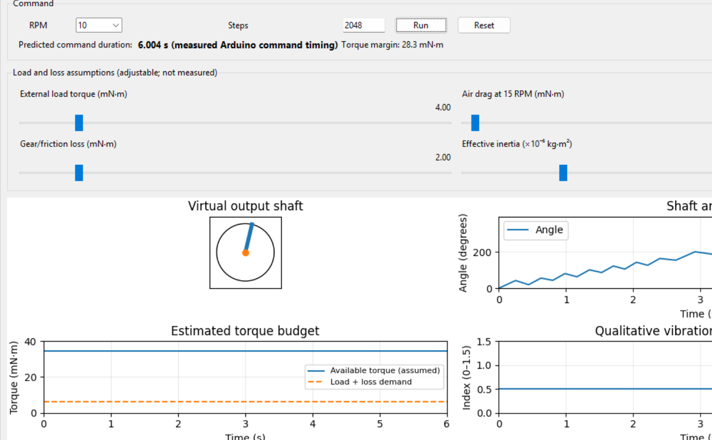
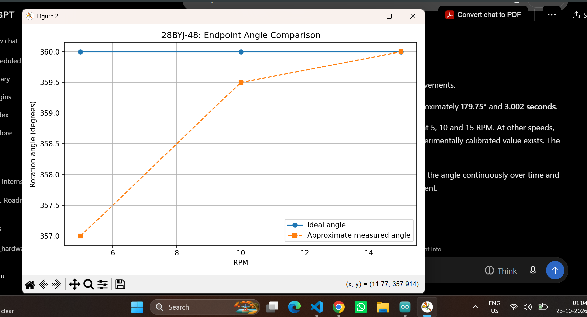
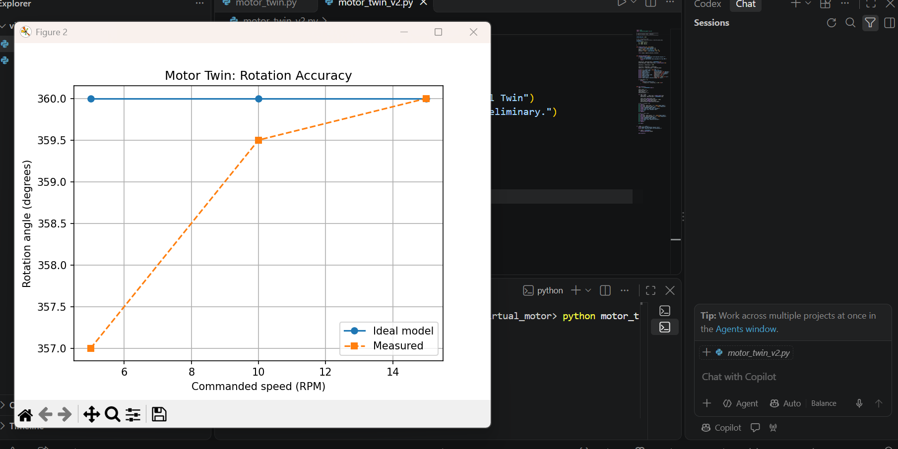
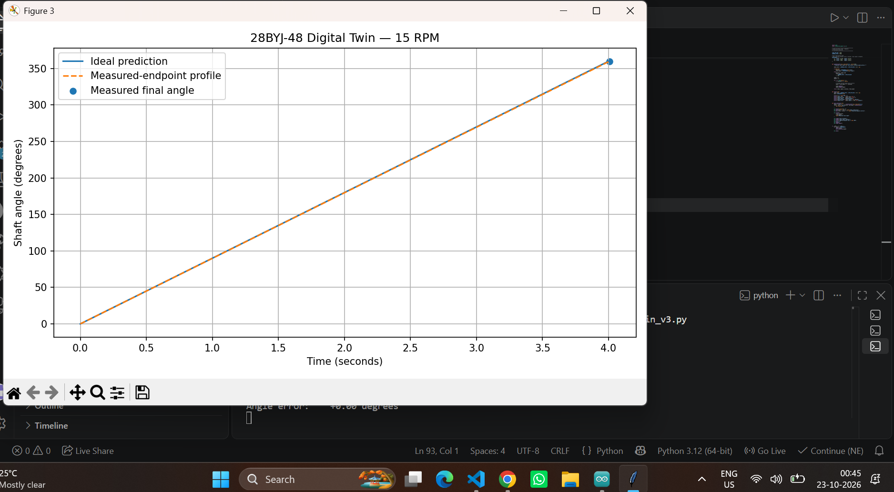
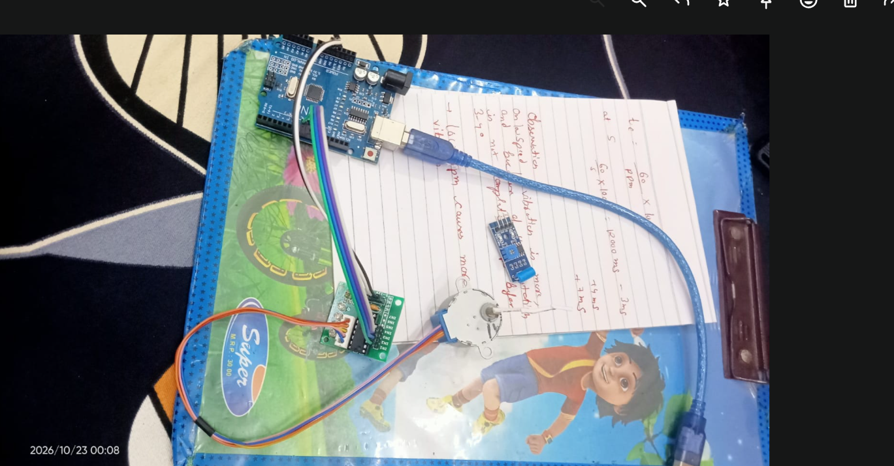
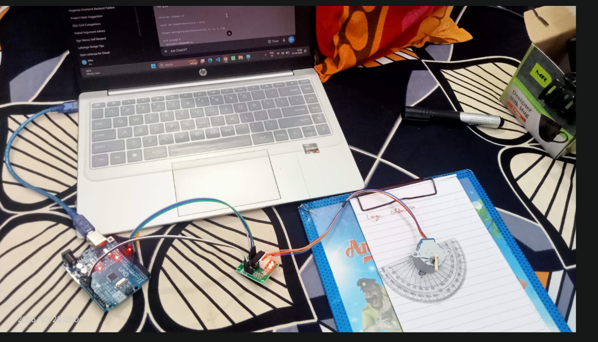

# Virtual Motor Simulation — 28BYJ-48

An interactive graphical simulation of a 28BYJ-48 geared stepper motor, developed with Python, Pygame, Tkinter and Matplotlib.

The project connects practical Arduino experiments with a virtual motor model. It includes a graphical shaft, adjustable operating conditions and plots for examining motor behaviour.

> **Model note:** This is an educational engineering approximation. It is not a fully validated electromagnetic digital twin or a manufacturer-certified model.

## Features

- Graphical representation of the motor and rotating output shaft.
- Adjustable commanded RPM and step count.
- Adjustable external load, gear/friction loss and effective inertia assumptions.
- Graphs for shaft angle, estimated torque budget and qualitative vibration/step-loss risk.
- Arduino command-duration observations used at selected RPM values.
- Earlier development versions preserved in `archive/development_versions/`.

## Project gallery

### Main simulation dashboard



### 15 RPM performance plot



### Endpoint angle comparison



### Rotation accuracy comparison



## Physical hardware and experimental setup

The physical setup used an Arduino Uno, a 28BYJ-48 stepper motor and its driver board. A protractor was used in the experimental arrangement to observe approximate rotation angle.

### Hardware components



### Experimental angle measurement



## Requirements

- Python 3.9 or later
- Pygame
- Matplotlib

Install the required libraries:

```bash
python -m pip install -r requirements.txt
```

## Run the project

```bash
python motor_twin_v11.py
```

The application uses a Tkinter control/analytics window and a separate Pygame motor-visualisation window.

## Experimental observations

The following command-duration observations were recorded for 2,048 commanded steps:

| Commanded speed | Recorded command duration |
|---:|---:|
| 5 RPM | 11,997 ms |
| 6 RPM | 9,999 ms |
| 10 RPM | 6,004 ms |
| 15 RPM | 4,007 ms |

**Important:** These are command-duration observations. They should not be described as independently measured shaft-motion durations unless shaft movement was separately measured.

Approximate endpoint angle observations and calculations are documented in the development work. They are not a complete measurement of the shaft's motion throughout the run.

## Data and model transparency

The project uses three kinds of information:

1. **Experimental observations:** Arduino command-duration readings and approximate endpoint-angle observations.
2. **Published reference values:** Indicative 28BYJ-48 specifications. Values can vary by manufacturer and motor variant; add the exact datasheet or research citations used before treating them as definitive.
3. **Model assumptions:** Effective inertia, friction, external load and related settings are adjustable assumptions unless independently measured and calibrated.

## Limitations

- The motor rendering is stylised, not a CAD-accurate physical model.
- Torque/stall behaviour is simplified and should be interpreted as a scenario estimate, not a validated torque-speed or pull-out-torque model.
- The vibration value is a qualitative indicator, not measured vibration in physical units.
- The simulation does not fully model winding currents, magnetic fields or driver electronics.
- Results should be compared with independent hardware measurements before making claims about real motor performance.

## Repository structure

```text
Virtual-Motor-Simulation/
├── motor_twin_v11.py
├── README.md
├── requirements.txt
├── .gitignore
├── assets/
│   ├── screenshots/
│   ├── motor_photos/
│   
│   
└── archive/
    └── development_versions/
        ├── motor_twin_v1.py
        ├── motor_twin_v2.py
        ├── ...
        └── motor_twin_v11.py
```

## Development history

The `archive/development_versions/` folder contains the V1–V11 Python iterations supplied for this project. The root-level `motor_twin_v11.py` is the main version to run.

## Future improvements

- Validate shaft position with a separate measurement method.
- Improve the torque-speed and stall model using motor-specific measured data.
- Add measured vibration data.
- Include a short motor-rotation animation in `assets/animations/` when available.
